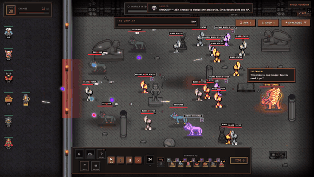
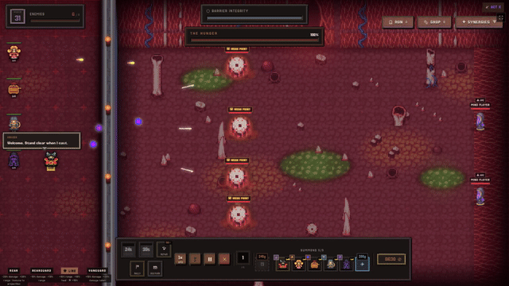
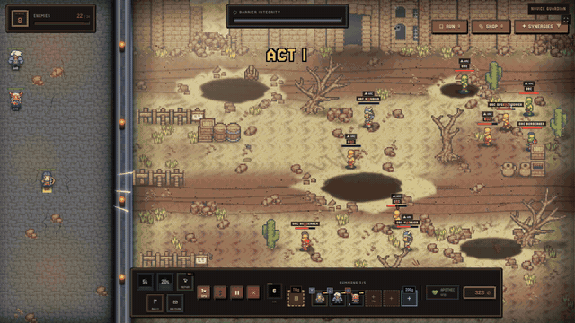
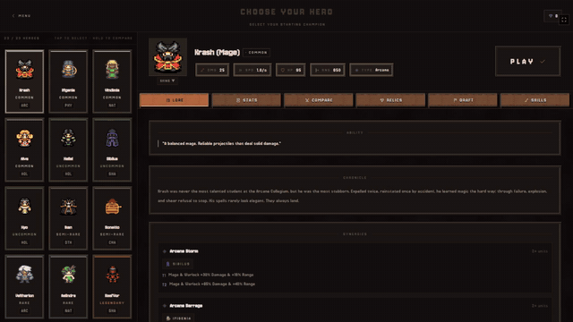

# Grimhold

Tower defense roguelike em pixel art dark fantasy, **lançado em acesso antecipado na Steam em 30/10/2026**.
Defenda a barreira, monte sua composição de heróis e sobreviva às ondas e aos chefes de cada ato.

**[Página na Steam](https://store.steampowered.com/app/5187440)**

  
  
  
  

> **Vitrine de código.** Este repositório mostra o código do jogo. Os GIFs acima são gravações do jogo. Sprites, interface, fontes e áudio vêm de pacotes licenciados que não permitem redistribuição e **não estão incluídos**, então o jogo não roda a partir daqui. O desenvolvimento acontece num repositório privado (~370 commits desde setembro de 2026).

## Stack

- **TypeScript + React 19**, renderização em canvas
- **Vite 6** para o bundle, **Electron 42** para o desktop
- **Steamworks** (`steamworks.js`): conquistas, overlay, builds separados de jogo completo e demo
- **i18n** em três idiomas (pt-BR, inglês e chinês simplificado), com script de verificação de chaves
- **Vitest**, com testes de regras de combate, chefes, habilidades dos heróis e atos

## Destaques técnicos

- Laço de jogo próprio em canvas, com ondas, chefes por ato, habilidades e sinergias entre heróis
- Sistemas de jogo separados da interface (`components/systems/`, `components/chefes/`), testáveis sem renderizar
- Conquistas da Steam ligadas ao progresso da conta
- Corte de conteúdo da demo em tempo de build (`vite build --mode demo`), gerando dois apps a partir do mesmo código

## Estrutura

| Pasta | O que tem |
|---|---|
| `components/` | Jogo, painéis, chefes, dados e sistemas |
| `electron/` | Processo principal e integração com a Steam |
| `i18n/` | Traduções |
| `tests/` | Testes de regras do jogo |
| `scripts/` | Ferramentas de build, tradução e dados |

---
Feito por Marcos Antonio Lisboa Junior · Elzerath Studio
